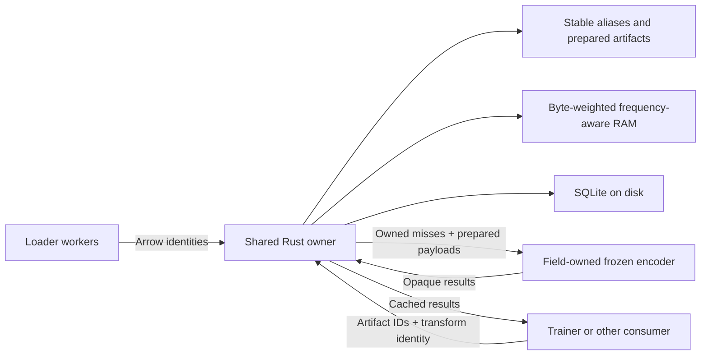

# Shared artifact cache prototype

A Rust store for reusable, deterministic artifacts across text, image, audio,
video, or another encoder system. The store handles opaque byte payloads and
stable IDs. Each caller owns its preprocessing, codec, encoder identity, and
output interpretation. Importing `relflow_cache` loads no relflow, Torch, or
Transformers modules.

The implementation is an optional Maturin/PyO3 package with a standalone Rust
owner. relflow's default Text cache and pure Python package build are unchanged.
The experimental Text extension is now a consumer of this shared store.
`rf.Image`, `rf.Audio`, and `rf.Video` are not implemented here.



The language-independent wire contract is documented in
[`PROTOCOL.md`](PROTOCOL.md).

The cache has two stages:

1. `lookup_arrow` resolves raw content identities to stable aliases.
   `bind` attaches deterministic prepared payloads and returns canonical artifact
   IDs. Different aliases with identical prepared bytes and preparation namespaces
   share an ID. Alias IDs and artifact IDs are separate domains.
2. `fetch` resolves `(artifact ID, transform namespace)` into cached results,
   owned misses, or pending work. An owned miss carries its prepared input.
   `publish` commits its result before acknowledging it. Disconnecting or
   explicitly releasing a connection makes unfinished work available again.

`Payloads` stores contiguous bytes and uint32 offsets, supporting fixed-width
vectors, variable-length sequences, patches, frame tokens, and empty results.
The Rust database and protocol contain no token lengths, tensor shapes,
float32 widths, or modality dispatch.

## What belongs to the caller

| Concern | Caller responsibility |
| --- | --- |
| Source identity | Content digest or immutable versioned locator; a mutable URL alone is insufficient |
| Preparation identity | Decoder/tokenizer version, resampling, sample rate, crop, frame window, normalization, and prepared-payload codec |
| Transform identity | Exact frozen weights, pooling, precision, and output codec version |
| Payload interpretation | Dtype, shape, offsets, timestamps, or other structure encoded with the bytes |
| Randomness | Apply random augmentation, jitter, dropout, and learned projections after reusable artifacts; include the exact view/seed if caching a particular deterministic view |
| Device storage | Field-owned Torch/device layouts and capacity policy |

An image and a frame from a video can share a prepared artifact when their
preparation namespace and encoded bytes are identical. The helper does not salt
identities with a field name or modality class. Conversely, changing an encoder,
sample rate, crop, or selected clip must change the appropriate namespace.
Namespacing is a caller contract; the store cannot infer the meaning of bytes.
Frozen outputs are reusable; outputs of a changing trainable encoder require a
new weight identity and usually do not benefit from this cache.

For a random image crop, for example, cache the decoded base image, then crop
outside that cached stage. Reusing an encoder result also requires the exact
crop identity in its key. Audio mixing and video frame sampling follow the
same rule: a frozen encoder alone does not make upstream augmentation reusable.

The Text adapter in [`python/relflow_cache/text.py`](python/relflow_cache/text.py)
owns tokenizer fingerprinting, token shape/header validation, the float32 vector
codec, and precision identities. It reuses relflow's existing Text encoder,
geometry, masks, gradients, and bounded Torch device table.

## Shared resources and large datasets

`Cache(path, memory=64 * 2**20)` lazily starts one owner. Fields opening the same
path and budget in a process share it. Conflicting budgets on the same open store
raise an error, including before the owner starts. `cache.share()` starts the owner before worker creation;
pickled/forked handles reconnect to the same capability-authenticated local
endpoint, without copying the store or an index of the corpus.

SQLite is the durable backing store for every prepared artifact and result.
Moka uses byte-weighted, frequency-aware admission for the shared RAM tier.
An entry larger than the RAM budget remains available from disk and is never
admitted to RAM. A zero-byte hot budget is supported. Eviction only removes
RAM copies. Aliases and results compete for one budget; database metadata
maintains entry counts without scanning the corpus.

The budget covers managed hot entries, including a logical per-entry charge;
it is not a process RSS limit. SQLite has a separate 4 MiB private page budget;
active request buffers, allocator overhead, worker processes, device tables,
and the OS file cache consume additional memory. Disk storage has no quota or
garbage collection yet. Disk-backed operation works beyond RAM, but this is not
a measured terabyte-scale or cold-drive throughput claim.

A batch is limited to 4,096 entries and a 32 MiB request/reply frame. Callers
must split large batches and cache media as bounded frames, clips, windows,
or chunks. This prototype does not stream an unbounded movie through one cache
entry. Prepared inputs are fetched from SQLite only for computation misses;
RAM prioritizes aliases and computed outputs. Compute claims are coordinated
within one owner, shared by its worker family. Independently started owners
or machines do not share claims or a global RAM budget.

## Minimal API

```python
import pyarrow as pa
from relflow_cache import Cache, Payloads

cache = Cache("/local/scratch/artifacts", memory=64 * 2**20)

# Identity includes immutable source content and preprocessing configuration.
refs = cache.lookup_arrow(pa.array([b"sha256:source-content"]), "decode-rgb/crop-full/v1")
if not refs.ready[0]:
    ids = cache.bind(refs, Payloads.from_values([prepared_image_bytes]), "rgb-shape-dtype-codec/v1")
else:
    ids = refs.objects

result = cache.fetch(ids, "encoder-weight-hash/pooling-mean/fp32/output-codec-v1")
# Statuses: 0 = this connection owns the miss; 1 = hit; 2 = another connection owns it.
# Compute owned misses in a batch, publish them, then retry pending IDs after wait().
# result.inputs and result.hits preserve their order within their respective statuses.
# Release claims on computation failure. Shared connections serialize whole
# fetch/compute/publish cycles with cache.resolve_lock.
```

String, large-string, string-view, binary, large-binary, binary-view, and
fixed-size-binary Arrow arrays are hashed in Rust through Arrow C Data. Hashing
and socket I/O release the GIL. Arbitrary callers can also supply batched SHA256
keys through `lookup_keys`. Python strings are materialized by Text only at a
cold tokenizer library boundary. The optional Python wire transport remains
available for an owner-only ablation.

## Build and validation

On a Linux host with Rust, Python >=3.12, and Maturin:

```bash
cd prototypes/cache
NATIVE_PYTHON=/path/to/python ./build-lab.sh
/path/to/python -m pip install wheels/*.whl
export RELFLOW_CACHE_OWNER="$PWD/target/release/cache-owner"
cd ../..
/path/to/python -m pytest -m integration prototypes/cache/tests
```

The owner executable is currently supplied separately from the wheel using
`RELFLOW_CACHE_OWNER`; neither Rust nor Maturin is required for the ordinary
relflow wheel. The sidecar binds loopback only and receives its random
capability through stdin. Payloads are bytes, not executable Python pickles.
CPU results use local TCP; shared-memory IPC is not implemented.

The lab validation covers generic opaque payloads shaped like token matrices,
RGB images, variable-length PCM audio, and video clips. It also covers Arrow
slices/Unicode/binary hashing, canonical deduplication, preparation conflicts and
atomic rollback, transform namespaces, bounded RAM and oversized entries,
durable reopen, claim handoff, malformed frames, worker sharing, random
augmentation outside pristine cached outputs, and real Text CPU/CUDA parity.
These media payloads are fixtures, not implementations or performance tests of
future public media fields.

The earlier text-specific prototype's performance evidence remains in
[`../text-cache/`](../text-cache/README.md), with its exact measured source
archive. Its throughput numbers describe that archived implementation.
[`benchmarks/regression.py`](benchmarks/regression.py) compares this generic
implementation with that previous native implementation on saved `user-badge`
snapshots, using the real loader and a tiny backward head. Each database format
warms independently, and timed epochs must execute zero frozen encoder calls.

## Lab results

The final generic wheel passed **29 integration tests** on `lab`, including
real CPU/CUDA Text parity and spawned/forked worker sharing. Both Rust unit
tests passed. The ordinary Text core tests passed locally (46 tests), with
Ruff and Pyrefly checks passing.

The final `user-badge` comparison used 8,192 nested snapshots with 17 Text
leaves, 149,019 valued text occurrences, and lengths 16/32/64. It ran the real
Arrow loader, frozen Text lookup, and a tiny backward head on the RTX 3090.
Medians of three runs per implementation/profile:

| Profile, zero workers | Previous native text store (snapshots/s) | Generic artifact store (snapshots/s) | Change | Previous / generic PSS (MiB) |
| --- | ---: | ---: | ---: | ---: |
| GPU cache | 3,321 | 3,344 | +0.7% | 1,650 / 1,640 |
| 8 MiB RAM + disk, GPU cache off | 2,068 | 2,049 | -0.9% | 1,338 / 1,344 |

The observed differences are small; this is a regression check, not a claim
of a new speedup. There were 12 final runs in seeded randomized order. Every
run completed at least two epochs and five timed seconds, with fully populated
starting stores and **zero encoder calls in both warm-up and timing**. Initial
preparation was performed separately so cold encoder allocation did not affect
only one side's memory measurements. Both implementations use native Moka and
bundled SQLite, isolating the generalization from the earlier Python-to-Rust
comparison. The backing disk's OS page cache was warm.

The head alone exceeded 200,000 snapshots/s; these loops measured roughly
2,000–3,400 snapshots/s, keeping model compute out of the bottleneck. All saved
first-batch outputs across the 12 final runs were exactly equal (maximum error
0.0). This is a warm data-path experiment, without full-model training, quality
measurements, media-encoder benchmarks, or a terabyte-scale dataset.

[Raw runs and source fingerprints](results/results.json),
[build hashes and validation](results/build-info.json), and the
[exact tested source snapshot](results/measured-source.tar.gz) are retained.
The final lab receipts are under `/tmp/relflow-generic-cache-20261110/final`;
initial preparation and exploratory receipts remain in the sibling
`measurements` directory. Complete local receipts are kept under
`private/generic-cache-results`.
