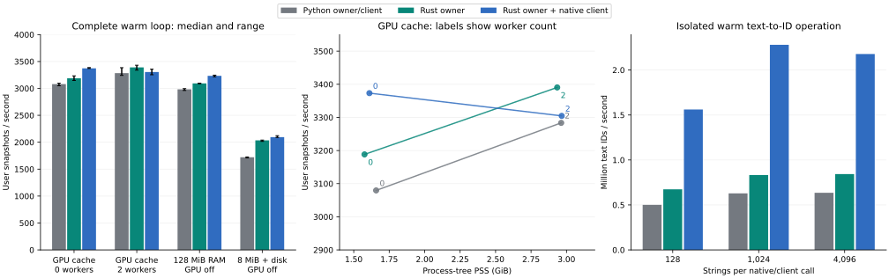

# Native shared text-cache benchmark archive

Historical measurements of the text-specific prototype. The current implementation
has moved to [`../cache/`](../cache/README.md) and accepts opaque artifacts for
multiple systems. The measurements and exact source archive below are unchanged;
they are not measurements of the generalized implementation. Source paths in this
report describe the archived implementation. The runtime source is retained in
`results/measured-source.tar.gz`.

Built and tested on `lab`: a standalone Rust cache owner plus an Arrow-aware
PyO3 client, packaged with Maturin. The native client improves isolated text-to-ID
lookup by **3.6 times** at batch size 1,024. Complete warm-loop gains are smaller:
**about 10% with no workers, 8% for shared-RAM vectors, and 22% with an 8 MiB
RAM budget and disk fallback**. The two-worker GPU-cache case is essentially
unchanged within the observed run spread.

The baseline here is the automatic Python/Moka cache from PR #94, rather than
the earlier NPY store. These are user snapshots per second:

| Profile | Workers | Python owner/client | Rust owner, Python client | Rust owner, native client | Full native gain |
| --- | ---: | ---: | ---: | ---: | ---: |
| GPU cache | 0 | 3,080 | 3,188 | 3,373 | +9.5% |
| GPU cache | 2 | 3,284 | 3,390 | 3,305 | +0.6% |
| 128 MiB shared RAM, GPU cache off | 0 | 2,983 | 3,093 | 3,233 | +8.4% |
| 8 MiB shared RAM + disk, GPU cache off | 0 | 1,721 | 2,035 | 2,095 | +21.7% |

Each cell is the median of three separate process runs, randomly interleaved
with seed 7302. The plot's whiskers show the observed minimum and maximum,
not confidence intervals. Every run completed at least two epochs and five
seconds of timing after a full warm-up epoch. The comparison executed 36 runs.

The practical resource result is **3,373 snapshots/s with no native-path workers**
at **1.61 GiB process-tree PSS**, comparable to the Python path's
**3,284/s with two workers** at **2.96 GiB**:
about **46% less process memory**. Worker count changes batch padding and
layout; exact parity checks therefore compare matching worker counts.

## What runs in Rust

- `src/store.rs`: byte-weighted Moka admission, stable IDs, canonical token
  rows, SQLite lookups/transactions, in-flight encoding claims, and counters.
  The wire protocol, SQLite layout, logical cache weights and page budget match
  the current Python implementation. It holds no corpus-sized in-memory index.
- `src/bin/owner.rs`: the authenticated local cache process and client lifecycle.
- `src/python.rs`: a batch PyO3 client. Arrow C Data imports provide direct
  access to UTF-8/offset buffers. Hashing and socket work release the GIL.
  The hot path does not materialize Python strings or call Rust once per item.
- `python/relflow_text_native/adapter.py`: an experimental `text_native`
  extension that reuses the existing Text tensorfield, masks, geometry,
  projections, encoder, and Torch device cache. Python strings are created
  only for tokenizer misses. This uses extension registration, with no runtime
  function replacements in the throughput loop.

The small package change passes Arrow values to the encoding context; the
existing Python context still performs its previous conversion. The benchmark
adds `--native-backend python|owner|full`. The owner-only mode is an ablation
that keeps Python hashing and transport.

Vectors still travel as bytes over local TCP on CPU-tier misses. This is not
shared-memory IPC. Frozen-encoder execution, Python configuration, and the GPU
lookup/projection path remain in Torch/Python. Native packaging is isolated
from relflow's existing build system.

## Why a faster cache does not yield a proportional loop speedup

The isolated warm text-to-ID test used real `user-badge` strings and checked
that no tokenizer ran. At 1,024 strings per call, Python delivered
**0.63 million text IDs/s**, versus **2.28 million/s** for full native.
That microbenchmark is one three-second run per backend/batch-size combination.

A separate eight-batch CPU profile left `text.resolve` at about **75 ms** for
Python and **74 ms** for full native. Both recorded **3,249 CUDA kernel launches**,
**726 stream synchronization calls**, and **363 `aten::nonzero` calls**. The native
cache does not remove this Torch work or the remaining loader work. A separate
warm encoder-fingerprint check took about **182 microseconds per call**, excluding
the initial weight hash. These diagnostics point to metadata reuse, batch
preparation, and device lookup/indexing as further targets; they do not establish
a speedup for those unimplemented optimizations.

For warm two-worker GPU throughput alone, these results do not justify replacing
the current service wholesale. The native approach is more useful when avoiding
workers or serving vectors through the CPU/disk tiers. The prototype keeps that
option measurable without changing the production default.

## Correctness and scope

- **9 native integration tests passed**: Arrow UTF-8/large-string/string-view
  slices and Unicode, cold fills, inference-to-training gradients, precision
  namespaces, pickle/deepcopy, disconnect recovery, durable reopen, malformed
  requests, spawn/fork workers, and real CPU/CUDA BERT parity.
- **2 Rust tests passed**, including a persisted 1,000-vector corpus under a
  2 KiB hot budget, canonical deduplication, transaction rollback, and claims.
- Full-corpus validation matched **58,167 string/length IDs** and **58,089
  vectors byte-for-byte**. The first populated per-field batches matched exactly
  across all **36 runs**, using references with the same worker count.
- The existing Python Text tests passed **77 tests**; the core suite passed
  **2,807 tests**. Ruff and Pyrefly passed.
- All timed frozen-encoder call counts were zero. These are text-only Arrow
  loader/lookup loops with a tiny backward head, not full model training or
  predictive-quality measurements. The same 8,192-snapshot fixture contains
  17 text leaves, six branches, and 149,019 text occurrences, with seed 7302.
- Fixture SHA-256:
  `eb14614a0afe1af4e30688506d1eff830128c3d763a5847cf032c0e0e1f3e396`.
  Vectors alone occupy about 85 MiB. The disk-fallback pages were OS-cache warm;
  no cold-drive or multi-terabyte throughput is claimed.

PSS includes trainer, workers and owner, sampled every 250 ms. It excludes GPU
memory and the kernel file cache; CUDA allocation is recorded separately.
Budgets limit charged hot state rather than whole-process RSS. Disk quota and
pruning are not implemented. The native engine uses bundled SQLite **3.51.1**;
Python uses SQLite **3.46.0**, so this compares complete implementations rather
than isolating the language change alone.

The host has 32 CPUs, 125 GiB RAM and an RTX 3090. Python 3.12.6, Torch 2.12.0+cu130,
Transformers 5.9.0, Polars 2.1.0, PyArrow 24.0.0 and NumPy 2.4.6 were used.
The native build used Rust 1.99.1, PyO3 0.29.3, Arrow 60.1.0, Moka 0.12.16,
rusqlite 0.38.0, and Maturin 1.16.0. Only Linux/Python 3.12 was exercised.

[Raw runs, counters and provenance](results/results.json),
[build hashes](results/build-info.json), [measured source snapshot](results/measured-source.tar.gz),
and [operator profile](results/profile-native.txt) are retained. The source
snapshot preserves the measured files before Rust formatting; the executable
and wheel checksums identify the exact binaries. Full traces and executable
artifacts remain at `/tmp/relflow-native-text-20261110` on the lab.

## Replay

The maintained build instructions and regression driver are in
[`../cache/README.md`](../cache/README.md). They build the generic store and compare
it against this previous native implementation using the same saved fixture.

The original runtime source is retained in
[`results/measured-source.tar.gz`](results/measured-source.tar.gz), over relflow
base commit `132cb118a6029c923482c0b2c3aa22a6f593fb9a`. The original complete lab
checkout, Rust project, wheel, sweep helpers, tests, and receipts remain under
`/tmp/relflow-native-text-20261110`; its `source` directory is the regression
driver's `--previous-source`. Its `deps` directory and built
`prototypes/text-cache/target/release/text-cache-owner` supply the previous
client and owner. The two prototypes use different database formats; the
regression driver prepares each independently.

The fixture can be regenerated with
`scripts/benchmarks/text-cache/prepare.py`. These historical measurements are
not refreshed by rebuilding the current generic implementation.
