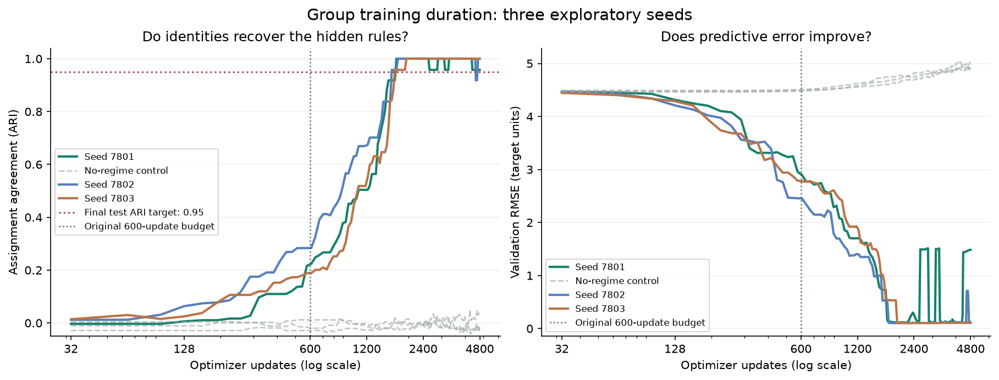

# Does Group need more training time?

Raw captures, logs, and input snapshots are in the [lab research archive](../README.md).

This is an exploratory lab study, not the canonical P078 result or a paired
Evidence CI run. It compares the P078 Group model at 600 and 4,800 optimizer
updates for seeds 7801, 7802, and 7803. All six trials completed successfully;
the per-trial JSON records, logs, and exit codes are in `output/`, and input
checksums, the image ID, and CPU model are in `input/`. The separately recorded
two-step smoke run is not a learning result.

Each run uses P078's four groups, 64 identities, 4,096 training and 1,024
validation records, AdamW learning rate 0.003, batch size 128, EMA decay 0.99,
and its stable and no-regime arms. It evaluates 2,048 independent test
observations of the same identities, plus P078's shuffled-test-ID control.
The same seeds, data, initialization, optimizer, and evaluation are used at
both budgets. `run.py` imports the exact proof and raises its `BUDGET` cap to
4,800 before calling it; it does not edit the canonical proof or its checks.

| Seed | Updates | Test ARI | Test normalized RMSE | Shuffled test nRMSE | No-regime test nRMSE |
| ---: | ---: | ---: | ---: | ---: | ---: |
| 7801 | 600 | 0.224 | 0.655 | 1.285 | 1.008 |
| 7801 | 4,800 | 0.958 | 0.329 | 1.366 | 1.114 |
| 7802 | 600 | 0.283 | 0.545 | 1.300 | 1.004 |
| 7802 | 4,800 | 1.000 | 0.025 | 1.397 | 1.099 |
| 7803 | 600 | 0.189 | 0.621 | 1.299 | 1.003 |
| 7803 | 4,800 | 1.000 | 0.025 | 1.410 | 1.096 |

All three runs at 600 missed P078's ARI ≥ 0.95 and normalized RMSE ≤ 0.35
gates. All three at 4,800 met every existing P078 check. The original budget
therefore appears too short for these three seeds on this synthetic task.

The improvement is not uniformly stable. Seed 7801 matched 63 of 64 identities
to the true partition at 4,800, and its test error was only just under the
0.35 threshold. After 2,400 updates, its recorded validation RMSE ranged from
0.108 to 1.514, while its assignments oscillated near the ARI threshold. The
other two seeds ended with all 64 identities matched; seed 7802 also showed
a transient later validation-error spike. Longer training alone is not proof
of robust convergence.

The chart uses actual end-of-epoch observations from the 4,800-step trials;
the x-axis is logarithmic. Dashed gray lines are separate no-regime control
fits. The horizontal ARI line is P078's **final test** criterion; the right
panel is unnormalized **validation** RMSE. The 600- and 4,800-step test
measurements in the table are separate fits. The intermediate points in the
chart are not independent test evaluations.

All fits ran in six network-disabled containers on the lab's AMD Ryzen 9
7950X3D, each with a 2-CPU and 4-GiB limit and one Torch thread. Trial times
were roughly 38 seconds at 600 updates and 276 seconds at 4,800, including
both arms and evaluation under concurrent execution; these are not CI timing
forecasts. The original run is `~/relflow-research/runs/group-training-time-20261109-v1`.

To replay, use a new directory with `input/package` populated from the wheel
identified in `input/SHA256SUMS`, plus this study's `run.py` and `run.sh` and
the recorded `regime_recovery.py`, `reporting.py`, and `source.py` under their
respective `input/` paths. Create `output/`, then run `bash
input/research/group-training-time-20261109/run.sh` from the new directory.
`plot.py` reads the copied JSON records to regenerate the figure.

The seeds and budget were explored here, so the selection needs independent
confirmation on new seeds and the unchanged paired CI protocol. Results cover
strongly separated balanced rules and known identities, not unseen identities,
less separated regimes, or a parameter-matched Category comparison.
