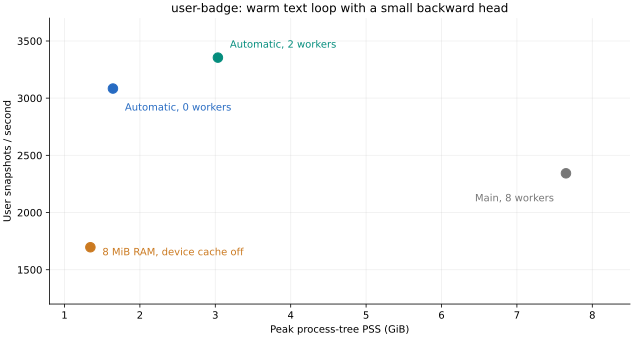

# Text cache throughput on the lab

The automatic cache reached **3,355 user snapshots/s with two workers**,
versus **2,343 snapshots/s for the eight-worker persistent-store baseline**:
**43% higher throughput and 60% less process-tree PSS**.
With no workers, the automatic cache reached **3,084 snapshots/s**
using **79% less process memory** than that baseline.
These figures describe the data and frozen-text loop below, rather than full model training.



| Configuration | Workers | Snapshots/s | Peak tree PSS, GiB | Average CPU cores |
| --- | ---: | ---: | ---: | ---: |
| Persistent store + token LRU | 8 | 2,343 | 7.65 | 3.13 |
| Automatic cache | 2 | 3,355 | 3.03 | 2.10 |
| Automatic cache | 0 | 3,084 | 1.64 | 1.13 |
| 8 MiB RAM, no device cache | 0 | 1,696 | 1.34 | 1.10 |

The automatic configurations use the default 64 MiB managed RAM budget and
CUDA device budget, except the last row, which uses 8 MiB RAM and `resident=0`.
The latter deliberately fetches vectors through the shared RAM/disk tiers.
Every timed loop made **zero frozen-encoder calls**. No lookup, tokenizer, or
encoder implementation was replaced. Forward hooks only counted encoder calls.

## Workload and method

- Host: `lab`, Linux, 32 logical CPUs, 125 GiB RAM, RTX 3090 24 GiB.
  Python 3.12.6, Torch 2.12.0+cu130, Transformers 5.9.0, PyArrow 24.0.0,
  Polars 2.1.0, NumPy 2.4.6, Moka 0.5.0. Local checks use locked Polars 2.0.0.
- Source: `rel-stack/user-badge` training anchors. Seed 7302 selects 8,192
  snapshots without replacement from 3,386,276 anchors by
  `hash(UserId, timestamp, seed)`. SQL preserves the recipe's timestamp cutoffs,
  64-row history caps, and eight-comment nested caps. Only the 17 Text leaves
  and their six branches enter this experiment; targets and non-text fields
  do not enter the timed computation.
- The saved Arrow fixture is 72,211,669 bytes, with 149,019 valued text
  occurrences and 58,167 unique string/length pairs. Token canonicalization
  merges these into 58,089 rows. MiniLM-L6-v2 uses mean pooling, float32,
  width 384, and token limits 16/32/64. Vectors alone occupy about 85 MiB.
- Batch size 64. Each loop uses the real `ArrowDataModule`, tensorization,
  process transport, CUDA transfer, and `Text` lookup. Frozen vectors feed
  a tiny linear head and backward pass. The head-only ceiling is recorded
  separately and exceeds the measured loop by more than 50 times.
- One complete warm-up epoch precedes timing. The legacy baseline was already
  persisted and resident; the replay harness also flushes and primes fresh
  legacy stores before timing. At least two whole timed epochs and five
  timed seconds are required. Snapshot counts are checked each epoch.
  Sampling/order stays fixed; in-memory workers stride the input rows, so
  batch layouts and padding depend on worker count.
- Matching-worker first batches agree with current-main vectors to a maximum
  absolute difference of **1.38e-6** (`rtol=1e-5`, `atol=1e-5`). Repeated
  warm-cache passes agree exactly. This validates vector reuse; it measures
  no predictive quality.
- PSS is sampled across trainer, workers, and cache owner every 250 ms. CUDA
  allocation and CPU seconds are separate fields in the raw receipt. PSS
  excludes GPU memory and the kernel's file cache. There is one process run
  per configuration, so these are individual measurements without confidence
  intervals. Disk rows were OS-cache warm; this does not measure cold-drive
  or multi-terabyte throughput.

[Raw results and provenance](user-badge.json) retain all epoch timings,
latencies, payload sizes, cache counters, input/source hashes, and the initial
11-case worker/budget sweep. That initial sweep used the lab's older Polars
1.44.1 environment; the table above was rerun within the supported Polars 2
range. The exploratory baseline worker counts were 0, 2, and 8.
The runtime under test is `633848b`; the baseline is `a912f29`.

The cache sends one int64 per slot. Matched zero-worker first batches fell
from 17,711,104 token bytes to 180,736 ID bytes (98 times smaller).
Smaller hot budgets trade throughput for memory. This is a reusable mechanism
for frozen encoders, with workload-dependent benefit; it is not a universal
speedup. Disk entries persist without a quota and managed budgets cover hot
cache state rather than the whole process.

## Replay

[prepare.py](prepare.py), [user-badge.sql](user-badge.sql), and
[user-badge.fields.json](user-badge.fields.json) build the fixture from a local
relbench cache. They do not download data or train a model. The preparer was
rerun on the lab with DuckDB 1.5.5 and reproduced the recorded Arrow SHA-256:
`eb14614a0afe1af4e30688506d1eff830128c3d763a5847cf032c0e0e1f3e396`.

From the repository root, with rel-stack cached and MiniLM assets available:

```bash
uv sync --locked --all-extras
uv run python scripts/benchmarks/text-cache/prepare.py --output /tmp/user-badge-input
uv run --with psutil python scripts/benchmark_text_cache.py \
  --input /tmp/user-badge-input --store /tmp/automatic-text \
  --workers 0 --output /tmp/automatic-0.json --save-vectors
uv run --with psutil python scripts/benchmark_text_cache.py \
  --input /tmp/user-badge-input --store /tmp/automatic-text \
  --workers 2 --output /tmp/automatic-2.json --save-vectors
uv run --with psutil python scripts/benchmark_text_cache.py \
  --input /tmp/user-badge-input --store /tmp/automatic-text \
  --memory 8 --resident 0 --output /tmp/spill.json --save-vectors
```

The harness requires Linux/CUDA for process PSS and device measurements.
Set `HF_HUB_OFFLINE=0` for the first asset download if necessary.
For the baseline, run this same harness with `PYTHONPATH` pointing to an
`a912f29` checkout's `src`, `--mode legacy-local --workers 8`, and a separate
`--store /tmp/legacy-text`. Keep the same Python dependencies and saved input.
`--mode legacy-store` also measures the original persistent path without its
local tokenizer cache. Every JSON records its input checksum.
